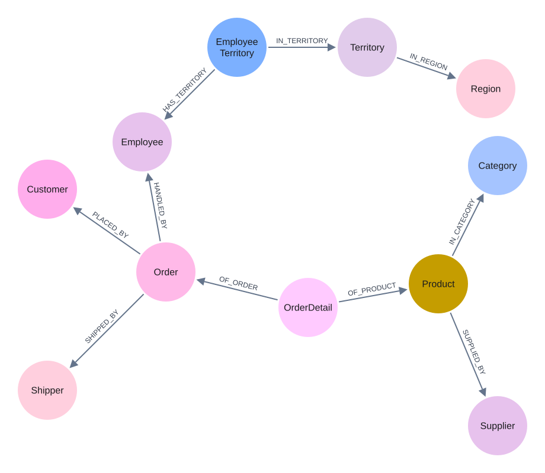

# Northwind

Compare graph embeddings before and after normalization using Northwind. **GDS is required.**

Complete the [setup](../../README.md#setup). Run all commands from the repository root.

## 1. Import data

The eleven CSVs are included in [data/dataset/](data/dataset/). Import into a dedicated database; the default is `northwind`.

```bash
python extend_experiment/northwind/data/import_data.py
```



Imported graph schema.

## 2. Run the embedding experiment

```bash
python extend_experiment/northwind/embedding/embedding_northwind.py
python extend_experiment/northwind/embedding/analysis/analysis.py
```

Outputs: [embedding results](embedding/embedding_results_undirection.json) and [report](embedding/analysis/result.md). The default orientation is `UNDIRECTED`.

## Saved FD results (optional)

The original FD runner is not included. Generate reports and figures from the saved results:

```bash
python extend_experiment/northwind/analysis/analysis.py
```

Output: [analysis/output/](analysis/output/).

For Community, add `--database neo4j --constraint-type unique` to the import command and `--database neo4j` to the embedding command.
