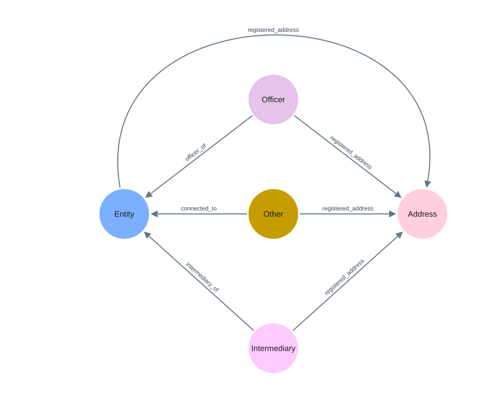

# Offshore Leaks

Compare redundancy, updates, embeddings, use cases, and entity resolution on ICIJ's Offshore Leaks graph.

Complete the shared [setup](../README.md#setup). Run all commands below from the repository root.

## 1. Data and import

Download the [official ICIJ dataset](https://offshoreleaks.icij.org/pages/database):

```bash
python offshore_experiment/dataset/download_data.py
```

The five node CSVs and `relationships.csv` are saved in `offshore_experiment/dataset/data/`. The `LATEST` download can change; reproducing historical results requires the same snapshot.

Use a local Neo4j Enterprise installation with `neo4j`, `neo4j-admin`, and `cypher-shell` available:

```bash
export NEO4J_HOME='/absolute/path/to/your/neo4j-installation'
export PATH="$NEO4J_HOME/bin:$PATH"
python offshore_experiment/dataset/import_offshore_enterprise.py
```

The importer creates a new database, `offshorecsv` by default, and refuses to overwrite an existing database. Set `NEO4J_DATABASE` to use another new database for import and experiments.



Selected relationships from the imported graph.

After import, choose the experiments you need and run them one at a time. Each experiment runs independently; its analysis commands can also read existing result JSON without Neo4j. Rerunning overwrites the corresponding outputs.

Output paths below are relative to `offshore_experiment/`.

## 2. Embedding similarity

Measure how normalization changes cosine similarity for node pairs sharing a determinant value, with different-value pairs as controls. **GDS is required.**

```bash
python offshore_experiment/embedding/scripts/embedding_offshore.py
python offshore_experiment/embedding/analysis/analysis.py
python offshore_experiment/embedding/analysis/cos_similarity.py
```

Outputs: `embedding/results/embedding_offshore.json`, the report `embedding/analysis/result.md`, and the figure `embedding/analysis/cosine_similarity_ecdf.png`.

## 3. Redundancy and update cost

For 12 property-based functional dependencies (FDs), measure redundant values, normalization cost, and the cost of updating repeated copies versus one shared dimension node.

```bash
python offshore_experiment/redundancy/scripts/updates_offshore.py
python offshore_experiment/redundancy/analysis/analysis_update.py
```

Outputs: `redundancy/results/updates_offshore.json` and `redundancy/results/updates_offshore.md`.

## 4. Downstream use cases (U1–U3)

Evaluate determinant classification, similarity search, and the effect of complete or partial updates on embeddings. **GDS is required.**

```bash
python offshore_experiment/usecases/scripts/usecases_offshore.py
python offshore_experiment/usecases/analysis/analyze_usecases.py
```

Outputs: `usecases/results/usecases_offshore.json`, plus `usecases_offshore.md` and `usecase_partial_updates.png` in `usecases/results/report/`.

## 5. Entity resolution (U4)

Compare duplicate-entity detection before and after normalization, using known duplicate pairs for evaluation. **GDS is required.**

```bash
python offshore_experiment/usecases/scripts/er_offshore.py
python offshore_experiment/usecases/analysis/analyze_er.py
```

Outputs: `usecases/results/er_offshore.json` and `usecases/results/report/er_offshore.md`.

## 6. Updates through shared address references

For eligible Officer, Intermediary, and Entity groups sharing a `registered_address` reference, compare updating `sourceID` on every source node with updating it once on the shared Address node. Also measure normalization cost.

```bash
python offshore_experiment/usecases/scripts/updates_reference_fd.py
python offshore_experiment/usecases/analysis/analyze_updates.py
```

Outputs: `usecases/results/updates_reference_fd.json` and `usecases/results/report/updates_reference_fd.md`.

## Community edition (optional)

For Community, run `python offshore_experiment/dataset/import_offshore_community.py`. It stops Neo4j and **replaces the entire `neo4j` database**, ignoring `NEO4J_DATABASE`. Set `NEO4J_DATABASE=neo4j` for the subsequent experiments.
