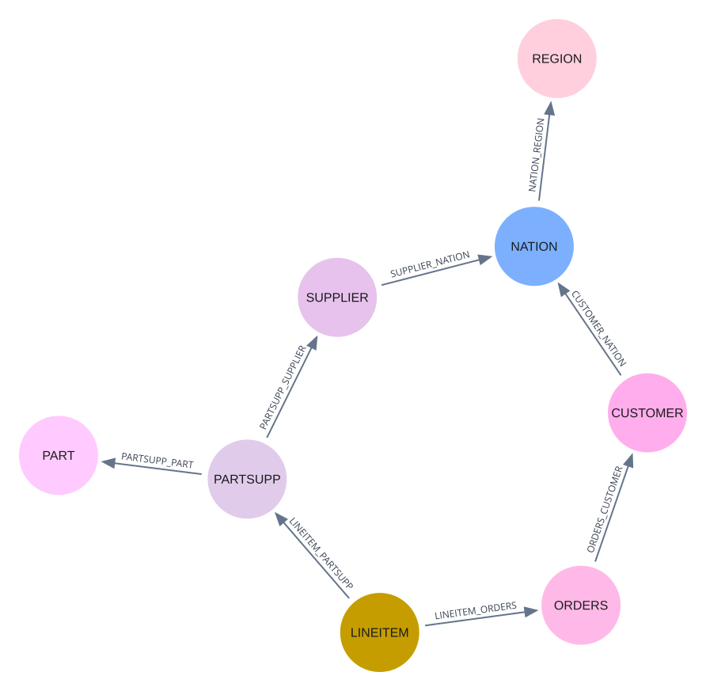

# TPC-H

Compare normalized and denormalized graphs for query performance, redundancy, and update cost.

Complete the shared [setup](../README.md#setup) first. Run all commands below from the **repository root**.

## 1. Data and import

The eight **SF 0.1** tables are included in [`data/tbl_sf_01/`](data/tbl_sf_01/). Use Neo4j Enterprise and a fresh, dedicated database; the importer creates `tpch-sf-01` by default.

```bash
python tpch_database_experiment/data/import_data_from_tbl_enterprise.py
```

### Imported schema



After import, choose either or both SF 0.1 experiments below. Run them one at a time. Rerunning overwrites the corresponding output files.

## 2. Query performance (SF 0.1)

Compare the original queries with 74 denormalized query templates. The experiment checks that results match and measures query time and materialization cost; the analysis generates comparison tables.

```bash
python tpch_database_experiment/query/scripts/run_benchmark.py --output-json outputs/tpch/query.json
python tpch_database_experiment/query/analysis/query_analysis.py --input outputs/tpch/query.json
```

Outputs: `outputs/tpch/query.json` and `outputs/tpch/query.md`. The query runner defaults to **SF 0.1**.

## 3. Redundancy and update cost (SF 0.1)

Compare 256 combinations of the eight foreign-key edges. Measure the resulting data redundancy, update time, and cost of rebuilding the normalized graph; the analysis summarizes these tradeoffs.

```bash
python tpch_database_experiment/redundancy/scripts/new_redundancy.py --database tpch-sf-01 --output outputs/tpch/redundancy.json
python tpch_database_experiment/redundancy/analysis/analysis_new.py --input outputs/tpch/redundancy.json
```

Outputs: `outputs/tpch/redundancy.json` and `outputs/tpch/redundancy.md`. If you set a custom `NEO4J_DATABASE`, update `--database tpch-sf-01` above to match.

Both analysis scripts read saved JSON and can be rerun without Neo4j.

## 4. Larger-scale use cases (SF 1, optional)

Evaluate selected query and update scenarios on a larger graph. These experiments are separate from the SF 0.1 runs and require Neo4j Enterprise.

Generate the eight tables with [TPC-H DBGEN](https://www.tpc.org/tpc_documents_current_versions/current_specifications5.asp), for example `./dbgen -s 1`, and place them in `tpch_database_experiment/data/tbl_sf_1/`.

### Redundancy and updates

Compare selected denormalization strategies at SF 1. This step **clears and rebuilds the target database**, defaulting to `tpch-sf-1-usecase` (or `NEO4J_DATABASE` if set).

```bash
python tpch_database_experiment/usecases/scripts/components/run_sf1_redundancy.py
python tpch_database_experiment/usecases/analysis/analyze_sf1_redundancy.py
```

Outputs under [`usecases/results/sf1/`](usecases/results/sf1/): `redundancy/new_redundancy_results.json` and `report/sf1_redundancy.md`.

### Query performance

On the SF 1 graph imported above, compare 20 query variants with their baselines. This step can be repeated without reimporting the data.

```bash
python tpch_database_experiment/usecases/scripts/components/run_sf1_queries.py
python tpch_database_experiment/usecases/analysis/analyze_sf1_queries.py
```

Outputs under `usecases/results/sf1/`: per-strategy JSON and logs in `query/`, and `report/sf1_queries.md`.

## Community edition (SF 0.1 only)

Run `python tpch_database_experiment/data/import_data_from_tbl_community.py --database neo4j`, and pass `--database neo4j` to both SF 0.1 experiment commands.
